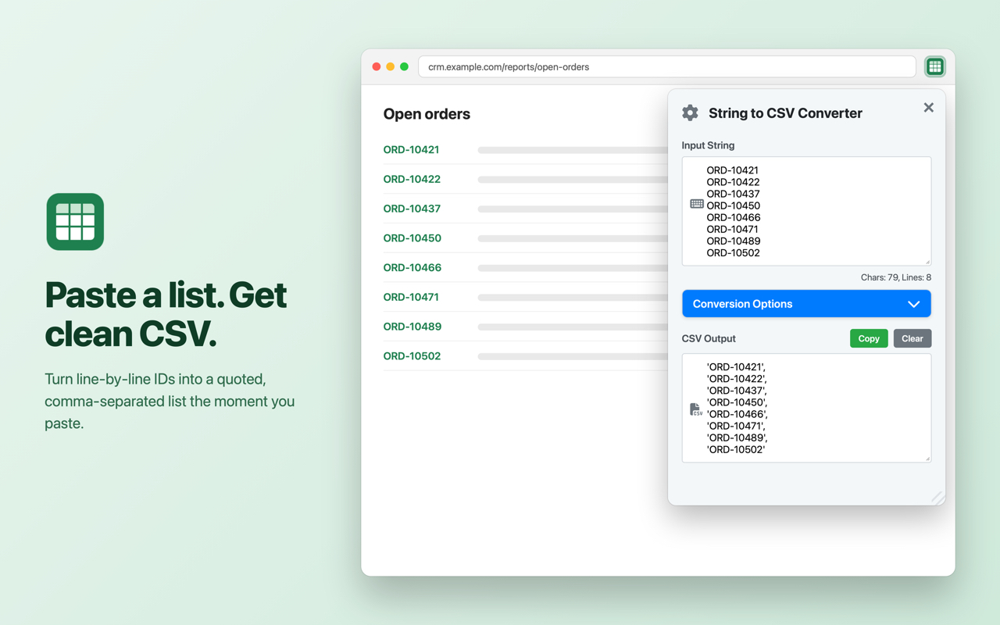
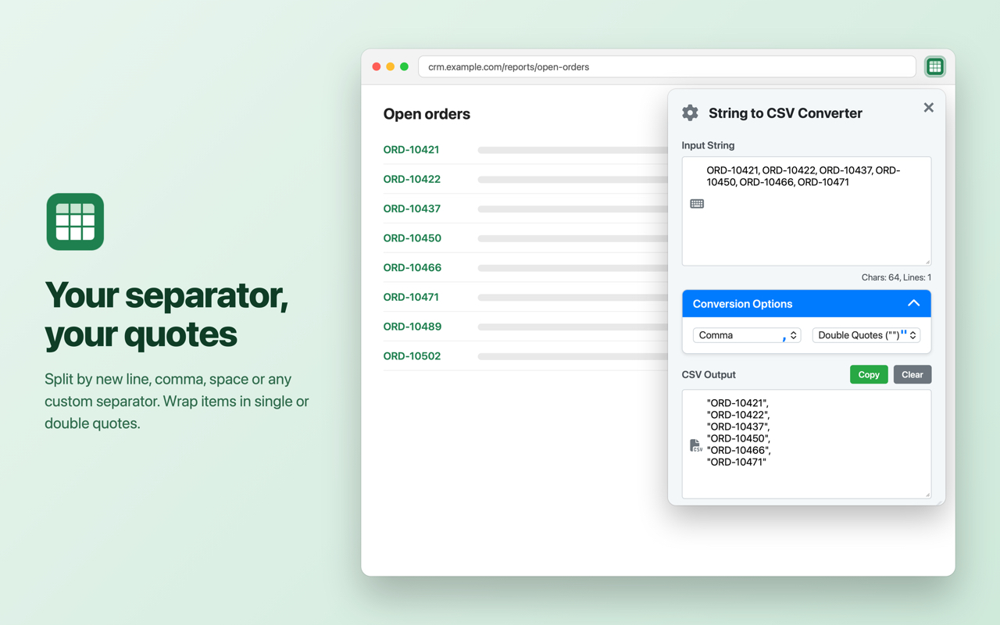
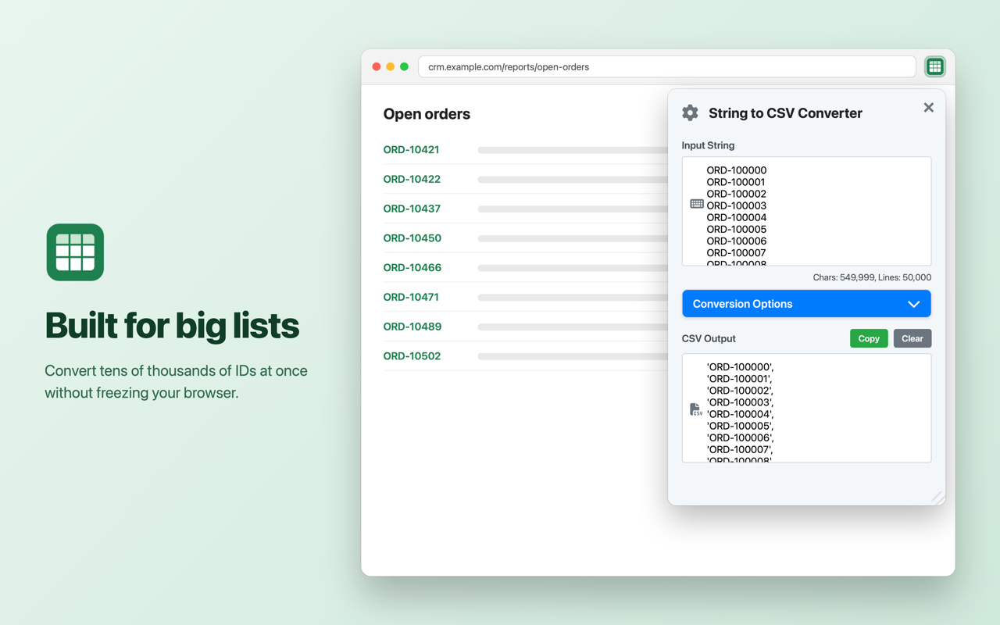
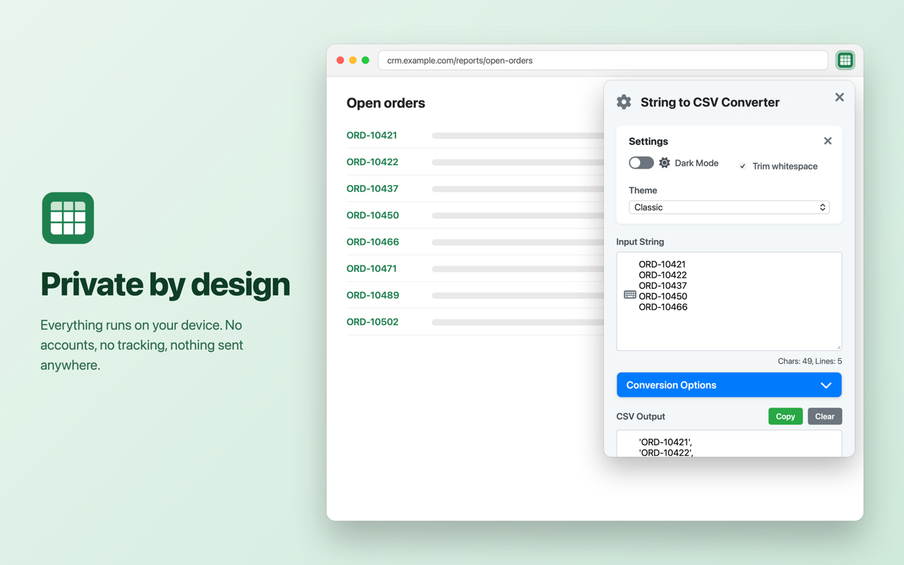

<p align="center">
  
</p>

<h1 align="center">String to CSV Converter</h1>

<p align="center">
  Paste a list of IDs or values and get a clean, quoted, comma-separated list instantly.<br />
  A browser extension for Chrome, Edge, Firefox and Safari.
</p>

## Download

| Browser | Get it |
| --- | --- |
| **Chrome** | [Chrome Web Store](https://chromewebstore.google.com/detail/string-to-csv-converter/hmjdjbmkhcdlnagembhlidibnlkdpmgo) |
| **Edge** | Install from the [Chrome Web Store](https://chromewebstore.google.com/detail/string-to-csv-converter/hmjdjbmkhcdlnagembhlidibnlkdpmgo) (Edge supports Chrome extensions) |
| **Firefox** (also LibreWolf, Zen, Waterfox, Floorp) | Firefox Add-ons: coming soon (in review) |
| **Safari** on Mac, iPhone and iPad | App Store: coming soon (in review) |

Every version's Chrome and Firefox zips are also attached to [GitHub Releases](https://github.com/lkusam/stringtocsv/releases).



## Features

- **Live conversion**: output updates as you type or paste.
- **Any separator**: split by new line, comma, space, or a custom separator (up to 5 characters).
- **Quote style**: wrap each item in single (`''`) or double (`""`) quotes.
- **Trim whitespace**: remove leading and trailing spaces from each item.
- **Big inputs**: handles inputs of up to 15 million characters without freezing.
- **One-click copy** and **Clear**.
- **Themes**: Classic or Material, light or dark.
- **Resizable popup**: drag the corner, or use `Ctrl/Cmd` `+` / `-` (and `0` to reset).
- **Keyboard shortcut**: `Cmd+Shift+D` (Mac) or `Ctrl+Shift+D` (Windows/Linux) opens the popup.
- **Remembers your settings** between sessions.

| | |
| --- | --- |
|  |  |
|  | |

## How to use

1. Click the String to CSV icon in your browser's toolbar, or press `Cmd+Shift+D` / `Ctrl+Shift+D`. In Safari on iPhone and iPad, open it from the page menu (the icon at the left of the address bar).
2. Paste your values into **Input String**.
3. Open **Conversion Options** to pick the separator and quote style.
4. Click the gear icon for theme, dark mode and whitespace trimming.
5. Click **Copy** to put the result on your clipboard.

**Example**: these lines

```
ORD-10421
ORD-10422
ORD-10437
```

become

```
'ORD-10421',
'ORD-10422',
'ORD-10437'
```

## Privacy

Everything runs locally in your browser. The extension collects nothing, sends nothing anywhere, and only uses the browser's extension storage to remember your settings. Its only permission is `storage`. See the [privacy policy](https://lkusam.github.io/stringtocsv/privacy.html).

---

## Development

### Build

Run `./build.sh`. It creates one folder per browser under `dist/` and zips the Chrome and Firefox builds:

```
dist/
├── chrome/                                   # load unpacked in Chrome / Edge
├── firefox/                                  # includes the Firefox-only manifest settings
├── safari/                                   # packaged by the Safari Xcode project
├── string-to-csv-converter-chrome-v<version>.zip
└── string-to-csv-converter-firefox-v<version>.zip
```

Try it locally:

- **Chrome / Edge**: open `chrome://extensions`, turn on Developer mode, click **Load unpacked** and pick `dist/chrome`.
- **Firefox**: open `about:debugging#/runtime/this-firefox` → **Load Temporary Add-on…** and pick `dist/firefox/manifest.json`.
- **Safari**: open `safari/String to CSV/String to CSV.xcodeproj` in Xcode and run the macOS or iOS scheme. It packages `dist/safari`, so run `./build.sh` first.

### Project layout

```
├── index.html, scripts.js, styles.css   # the popup
├── manifest.json                        # source manifest (build.sh adapts it per browser)
├── icons/                               # extension and app icons (icon.svg is the source)
├── vendor/fontawesome/                  # bundled Font Awesome icon font
├── build.sh                             # builds dist/<browser> and store zips
├── safari/                              # Safari Web Extension Xcode project (macOS + iOS)
├── screenshots/                         # store screenshots and the tools that render them
└── docs/privacy.html                    # privacy policy (GitHub Pages)
```

### Store screenshots

`screenshots/tools/render.sh` (macOS only) renders the real popup into captioned store images at each store's required size:

| Folder | Size | Use for |
| --- | --- | --- |
| `screenshots/mac-app-store/` | 2880×1800 | Mac App Store |
| `screenshots/iphone-app-store/` | 1320×2868 | App Store, iPhone 6.9″ |
| `screenshots/ipad-app-store/` | 2064×2752 | App Store, iPad 13″ |
| `screenshots/chrome-web-store/` | 1280×800 | Chrome Web Store, Edge Add-ons |
| `screenshots/firefox-addons/` | 1280×800 | Firefox Add-ons |

Captions and sample data live in `screenshots/tools/scenes.js`. Only the Chrome set is committed (the README uses it); run `render.sh` to recreate the rest.

## Releasing

Store uploads are manual. GitHub Actions only builds the zips.

1. Bump `version` in `manifest.json` and merge to `main`.
2. The **Build Release Zips** workflow runs `./build.sh` and creates a GitHub release `v<version>` with the Chrome and Firefox zips attached. If that version's release already exists, it builds but doesn't publish anything.
3. Download the zips from the release and upload them to each store, as described below.

### Chrome

Chrome Web Store Developer Dashboard → select the item → **Package** → **Upload new package** → choose `string-to-csv-converter-chrome-v<version>.zip` → **Submit for review**.

### Firefox

addons.mozilla.org → Developer Hub → **My Add-ons** → String to CSV converter → **Upload New Version** → choose `string-to-csv-converter-firefox-v<version>.zip` → answer **No** to the source code question → add release notes → **Submit Version**.

### Safari

Each release is archived and uploaded from Xcode on a Mac. The project is set to the BYTESEED LLC team (`2RFAV6KVU4`) with automatic signing and bundle IDs `com.byteseed.StringToCSV` / `com.byteseed.StringToCSV.Extension`, so Xcode → Settings → Accounts must be signed in to an Apple ID on that team.

1. Merge the version bump to `main` and pull it, then run `./build.sh`.
2. In Xcode, set **Version** (MARKETING_VERSION) to the manifest version on all four targets, and increase **Build** (CURRENT_PROJECT_VERSION). Every upload needs a new build number.
3. Select the **String to CSV (macOS)** scheme, run **Product → Archive**, then in the Organizer choose **Distribute App → App Store Connect → Upload**.
4. Repeat with the **String to CSV (iOS)** scheme and the **Any iOS Device** destination.
5. In App Store Connect, select the new build for each platform and **Submit for Review**.

## Changelog

### v2.6

- Firefox and Safari (Mac, iPhone, iPad) support
- New toolbar and store icons
- Font Awesome bundled, so icons work offline
- Removed debug logging (including logging of input text) and unused files

### v2.5

- Material Design 3 theme, light/dark modes
- Drag-to-resize popup with size memory
- Live character and line counters
- Better handling of large inputs

### Earlier

- **v1.3**: performance improvements and keyboard shortcuts
- **v1.2**: custom separators and better error handling
- **v1.1**: dark mode and saved settings
- **v1.0**: first release
